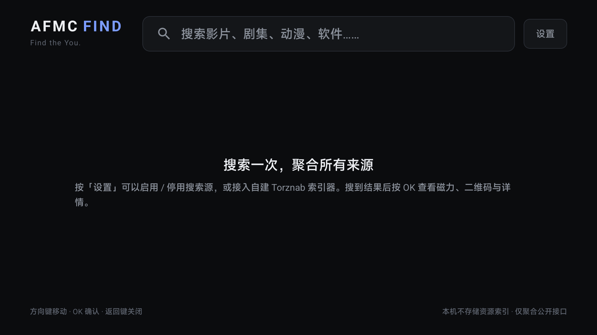
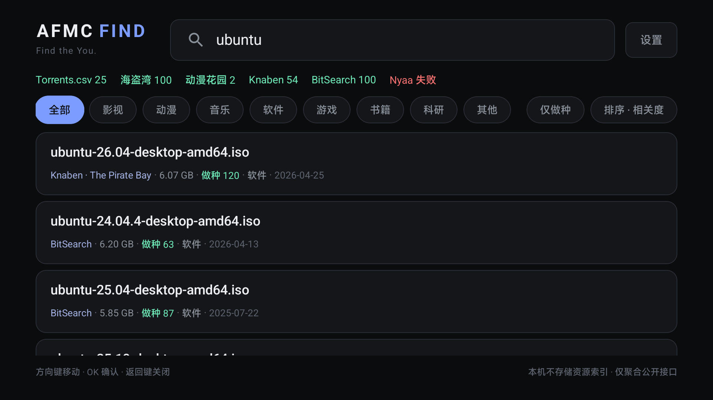
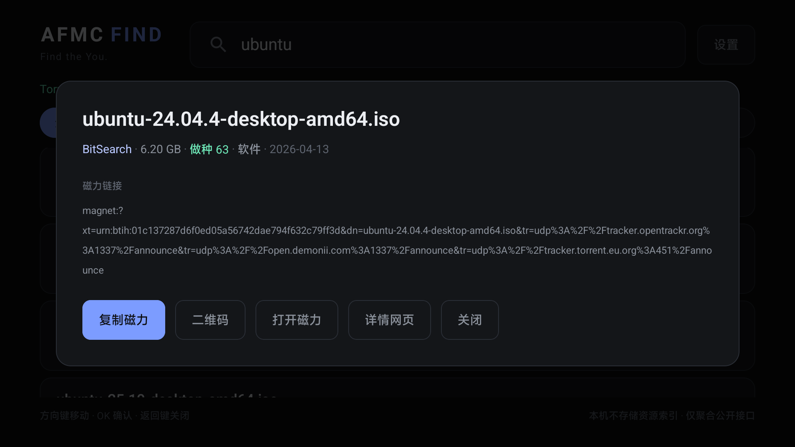
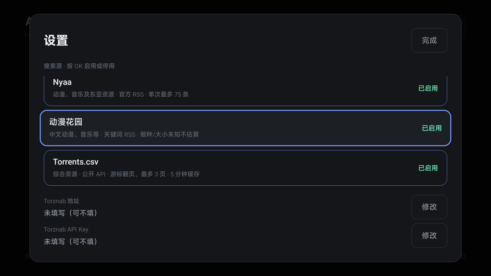

# AFMC FIND · Android TV

[AFMC-FIND](https://github.com/keyouchen16-hub/AFMC-FIND) 的 Android TV 版本：把桌面端的“多源聚合搜索 + 去重排序”搬到电视大屏，用遥控器完成搜索、筛选、查看磁力与扫码取种。

**Find the You.**

| 搜索 | 结果 | 详情 | 设置 |
| --- | --- | --- | --- |
|  |  |  |  |

## 这是什么

桌面版是 Windows WPF 应用，内含 libtorrent + VLC 的边下边播内核。WPF、DPAPI、Windows 原生播放器都无法在 Android 上复用，因此 TV 版是**按同一套搜索与排序规则重写**的原生应用：

- 保留：多源并行搜索、按 infohash 去重、名称/年份/季集/分辨率约束、相关度与做种加权排序、分类筛选、来源状态。
- 重写：界面（Jetpack Compose，1080p 遥控器焦点导航）、输入（电视输入法）、磁力交付（复制、二维码、Intent 交给外部应用、详情网页）。
- 未移植：内置边下边播（依赖 Windows 侧 libtorrent/Python 运行库与 LibVLC，Android 端需另建 torrent 引擎）、Playwright 浏览器发现、仅桌面存在的站点适配。

## 性能

搜索链路按电视的弱 CPU 与高延迟网络重做：

- **结果边到边显示**：任一来源返回就立刻出结果，不再等最慢的源（首屏 0.5–0.7s，旧版 2.7s）。
- **5 分钟内存缓存**：同一关键词二次搜索 0.0ms/源命中，0.4s 出结果。
- **启动连通性探测**：不可达的来源在启动时标记冷却（2–30 分钟），后续搜索直接「跳过」，不为死链反复等超时。
- **正则预编译**：排序器原来每行动态编译十余个正则，280 条结果要 2.4s；改为类加载时编译一次。
- **4 秒软截止**：慢源不再阻塞界面，结果在后台继续补齐。
- **短超时**：连接 8s / 读取 12s / 单源 10s，失败快速回到界面。

实测（小米电视 S Pro，Android 14，Wi-Fi 6）：

| 场景 | 首屏结果 | 全部完成 |
|---|---|---|
| 冷启动搜索 `ubuntu` | 0.55s | 3.5s |
| 同一关键词再搜 | 0.38s | 1.2s |
| 优化前 | 2.7s | 17.5s |

## 功能

- DNS 优先 IPv4，避免部分网络 IPv6 路由不可用导致的超时。
- 6 个内置搜索源并行查询：Knaben、BitSearch、海盗湾（APIBay）、Nyaa、动漫花园、Torrents.csv。
- 可选接入自建 **Torznab / Jackett** 索引器（地址 + API Key，支持局域网 HTTP）。
- 同一 infohash 只保留做种最好的一条；排序按“关键词覆盖率 → 名称顺序 → 年份/季集约束 → 做种 → 时间”。
- 分类筛选（影视 / 动漫 / 音乐 / 软件 / 游戏 / 书籍 / 科研 / 其他）、仅看有做种、按相关度/做种/大小/时间排序。
- 详情页：完整标题、来源、大小、做种、类别、日期、磁力；主按钮「下载到夸克」= 复制磁力并直接打开电视上的夸克网盘（在「离线下载」里粘贴），未安装夸克时回退为系统磁力打开。
- 支持复制磁力、二维码（手机扫码取种）、其他应用打开、详情网页。
- 设置页：逐源启用/停用、Torznab 配置；配置保存在本机 SharedPreferences。

## 已验证

- 品牌：图标、Banner、界面强调色与桌面版对齐（粉色 F 标，`#F43F70`）。
- 设备：小米电视 S Pro 65 Mini LED（`MiTV_MFTR0`，Android 14 / SDK 34，1080p，armeabi-v7a），ADB 安装运行。
- 夸克：详情页「下载到夸克」已实测可拉起 `com.quark.yun.tv`（夸克网盘 TV 版），磁力同时写入剪贴板。
- “ubuntu” 搜索：Knaben 54、BitSearch 100、海盗湾 100、Torrents.csv 25、动漫花园 2，去重排序后列表正常；详情页、二维码、设置开关与滚动均实测通过。
- JVM 单测：词条规范化、匹配层级、做种加权、去重、磁力解析、RSS/Torznab、日期/大小解析全部通过；`LiveSourcesTest` 在开发机网络下 6/6 源可用。

## 已知限制

- **无内置播放/边下边播**：本版本定位为“大屏搜索 + 磁力交付”，按需求不内置播放器。
- **夸克只能“复制 + 打开”**：夸克网盘 TV 版不声明 magnet/分享 Intent（仅 `quicktv` 私有 scheme），无法把磁力直接塞进去；需要在夸克里登录后粘贴到「离线下载」。电视桌面图标是启动器缓存，重启电视后才会显示新 Banner。
- **网络**：应用强制直连，不读取系统代理。若电视残留了指向 `127.0.0.1` 的全局代理（本机实测存在），其他应用会全部请求失败，本应用不受影响。Nyaa 在部分网络会被连接重置，状态栏会显示“Nyaa 失败”，不影响其他源。
- 只做公开接口聚合，不内置任何账号、不做站内登录。

## 构建

要求：JDK 17、Android SDK 35（build-tools 35.0.0）、Gradle 8.10.2（仓库自带 wrapper）。

```bash
./gradlew assembleRelease
# 产物：app/build/outputs/apk/release/app-release.apk
```

发布签名：仓库不包含密钥。构建前在项目根目录创建 `keystore.properties` 与 keystore：

```bash
keytool -genkeypair -v -keystore keystore/afmc-find-tv.jks -alias afmc \
  -keyalg RSA -keysize 2048 -validity 10950
cat > keystore.properties <<'EOF'
storeFile=keystore/afmc-find-tv.jks
storePassword=你的密码
keyAlias=afmc
keyPassword=你的密码
EOF
```

未提供 keystore 时 release 产物未签名，`assembleDebug` 可直接安装调试包。

## 安装到电视

- ADB：电视开启「开发者选项 → USB 调试」，`adb connect <电视IP>:5555`，电视上点允许，然后 `adb install -r app-release.apk`。
- U 盘：把 APK 拷到 U 盘，用电视自带文件管理器或「当贝市场」等工具安装。
- 首次启动按遥控器 OK 打开搜索框；输入后按 OK（或键盘上的「搜索」键）提交。

## 测试

```bash
./gradlew testDebugUnitTest
```

覆盖：词条规范化、匹配层级、做种加权、去重、磁力解析、RSS/Torznab 解析、日期与大小解析。`LiveSourcesTest` 会真实请求 6 个公开源，无网络时自动跳过。

## 目录

- `app/src/main/java/com/afmc/find/tv/core`：排序、去重、链接解析、来源目录、搜索引擎。
- `app/src/main/java/com/afmc/find/tv/sources`：各搜索源解析。
- `app/src/main/java/com/afmc/find/tv/ui`：Compose TV 界面。
- `app/src/test`：JVM 单元测试与真实源冒烟测试。

## 隐私

应用只做公开接口聚合：不登录、不上传搜索词、不保存搜索历史与资源索引；启动时搜索框为空。配置与 Torznab Key 均只存本机。

## 许可

桌面版仓库未另行授予整体开源许可；本移植版沿用同一约定，仅供个人使用与学习。
